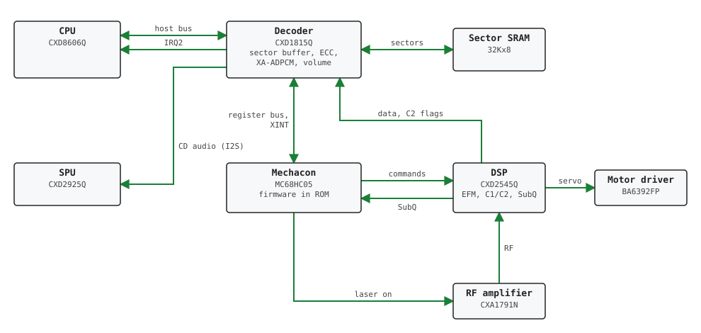
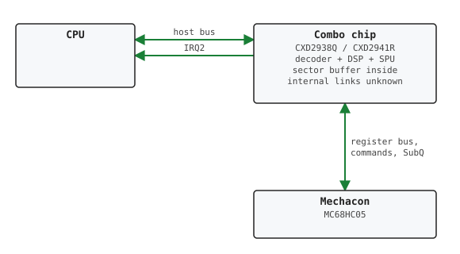
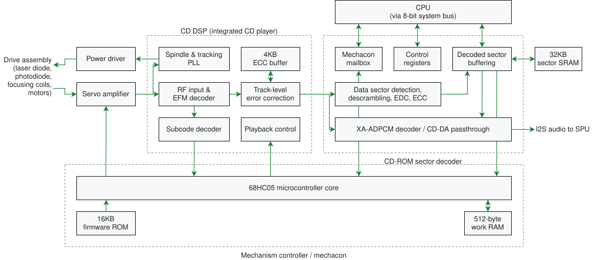

#   CDROM Drive Overview
The CD-ROM subsystem has four parts: a decoder, which is the only one the CPU
can reach, an HC05 microcontroller that runs the drive's commands, a DSP that
reads the disc, and the SPU, which plays the disc's audio. Later boards combine
some of them into one chip. Every register,
command, response and timing is on the [CDROM Drive](cdromdrive.md) page.



The diagram shows a PU-18 board (SCPH-5501). Older boards use a CXD1199BQ
decoder, and a CXD2510Q signal processor with a separate CXA1782BR servo
amplifier in place of the CXD2545Q.<br/>

- **Decoder** (CXD1199BQ, CXD1815Q). The only CD chip on the CPU bus, at
  1F801800h..1F801803h, and the source of IRQ2. It receives the serial data
  stream from the DSP, finds the sector headers, checks and corrects the sectors
  (EDC/ECC) and stores them in its 32 KB sector SRAM, where the CPU reads them
  through RDDATA. It decodes XA-ADPCM, applies the ATV volume matrix, and sends
  the CD-DA and XA-ADPCM audio to the SPU's CD audio input. It also holds the
  mailboxes between the CPU and the HC05: the command register, the parameter
  and result FIFOs, and the interrupt cause bits. The HC05 reaches it through a
  separate set of registers on a second bus, described in
  [CDROM Internal Info on PSX CDROM Controller](cdrominternalinfoonpsxcdromcontroller.md).
- **Mechacon** (MC68HC05). A microcontroller running firmware from its own ROM.
  It executes the commands: it controls the DSP and the servos with serial
  commands, reads SubQ directly from the DSP, programs the decoder (decoding
  mode, sector addresses, CD-DA and ADPCM mutes), writes the result bytes and
  posts the interrupt causes. It has no access to the CPU bus; everything it
  says to the CPU goes through the decoder.
- **DSP** (CXD2545Q). Demodulates EFM, performs the C1/C2 error correction and
  decodes the subcode. Sector data goes to the decoder together with the C2
  error flags, and SubQ goes to the HC05. It also runs the focus, tracking,
  sled and spindle servos through the motor driver.
- **SPU**. Receives the decoder's audio output on its first I2S input and mixes
  it with the volume set in
  [AVOLL/AVOLR](../spu/soundprocessingunitspu.md#0x1f801db0-avoll-i2sacd-rom-volume-left).

Later boards merge the chips in two steps. On PU-20 boards, the decoder and the
DSP are a single chip (CXD1817R) and the SPU is still separate. From PU-22
onwards, the decoder, the DSP and the SPU are a single chip (CXD2938Q, or
CXD2941R with the SPU RAM included), and there is no separate sector SRAM. The
HC05 remains a separate chip on every board. How the parts are connected inside
the combined chips is not known. The registers seen by the CPU behave like those of the separate decoder,
as far as is known.<br/>



Inside the chips, the same subsystem breaks down into these blocks:<br/>


#### Registers
The decoder's host interface is four bytes at 1F801800h..1F801803h, switched
between four banks through ADDRESS. The registers used to run a command are:<br/>
```
  COMMAND     command byte
  PARAMETER   parameter FIFO, written before the command byte
  RESULT      result FIFO (response bytes)
  HINTSTS     interrupt cause posted with each response (bits 0-2)
  HINTMSK     selects which causes raise IRQ2
  HCLRCTL     clears the cause once the response has been read
  HSTS        status: bank, FIFO states, BUSYSTS
  RDDATA      sector data, read by the CPU or by DMA channel 3
```
HINTSTS reports one of five causes: data ready, complete,
acknowledge, end, or error. All commands get an acknowledge (or an error),
and some a complete after it. Reads deliver one data ready per sector, and
Play one per report packet.
The full bit layouts are in
[CDROM Controller I/O Ports](cdromdrive.md#cdrom-controller-io-ports).<br/>

#### Command path
A command goes through the decoder and the HC05 in these steps:<br/>

1. The CPU writes the parameters to PARAMETER. They are queued in the decoder.
2. The CPU writes the command byte to COMMAND. The decoder latches it, sets
   BUSYSTS, and raises a "host command" flag in the interrupt status it
   presents to the HC05.
3. The HC05 firmware is a single loop that services the servos, SubQ, its
   timers and the decoder in turn. Once per pass, it reads the decoder's
   interrupt status. The decoder's interrupt line to the HC05 is not used as an
   interrupt. The command therefore waits in the decoder until the loop comes
   around, and how long that takes depends on what else the pass has to do (see
   [Response Timings](cdromdrive.md#cdrom-response-timings)).
4. Before taking the command, the HC05 checks the cause bits that the CPU sees
   in HINTSTS. If the CPU has not cleared the previous cause yet, the command is
   left where it is, and the check is repeated on the next pass.
5. The HC05 reads the command byte, reads parameters until the FIFO is empty,
   checks their count, and runs the command.
6. The HC05 writes the response bytes to the result FIFO, clears the host
   command flag and BUSYSTS, and then writes the cause (acknowledge, or error)
   into the decoder. The decoder shows it in HINTSTS bits 0-2 and raises IRQ2 if
   HINTMSK allows it.
7. The CPU reads RESULT and clears the cause through HCLRCTL. The HC05 sees the
   cleared bits on a later pass. It checks the same bits before posting a second
   response (complete, or error) and before taking the next command.

This has consequences for the CPU side:<br/>

- The time between a command write and its acknowledge varies from one command
  to the next, because it depends on where the HC05's loop is when the command
  arrives.
- BUSYSTS is cleared by the HC05, just before it posts the acknowledge or error
  cause.
- The command register holds one byte. A command written before the HC05 has
  taken the previous one replaces it.
- A command written while a cause is still set in HINTSTS waits until the CPU
  clears that cause.
- The HC05 reads the parameters when it takes the command, so all of them have
  to be written before the command byte.
#### Related pages
[CDROM Drive](cdromdrive.md)<br/>
[CDROM Format](cdromformat.md)<br/>
[CDROM File Formats](cdromfileformats/index.md)<br/>
[CDROM Video CDs (VCD)](cdromvideocdsvcd.md)<br/>
[CDROM Internal Info on PSX CDROM Controller](cdrominternalinfoonpsxcdromcontroller.md)<br/>
